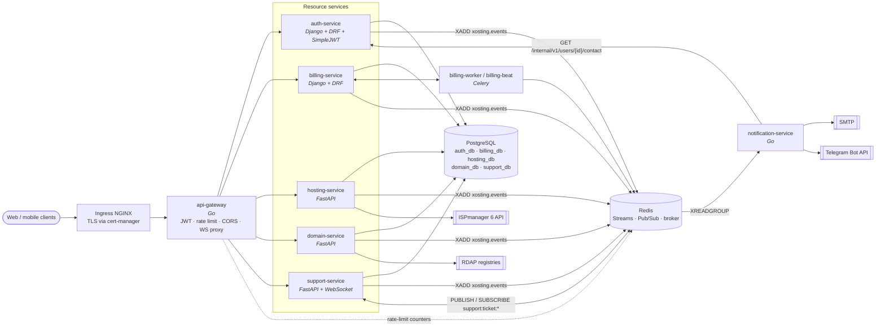
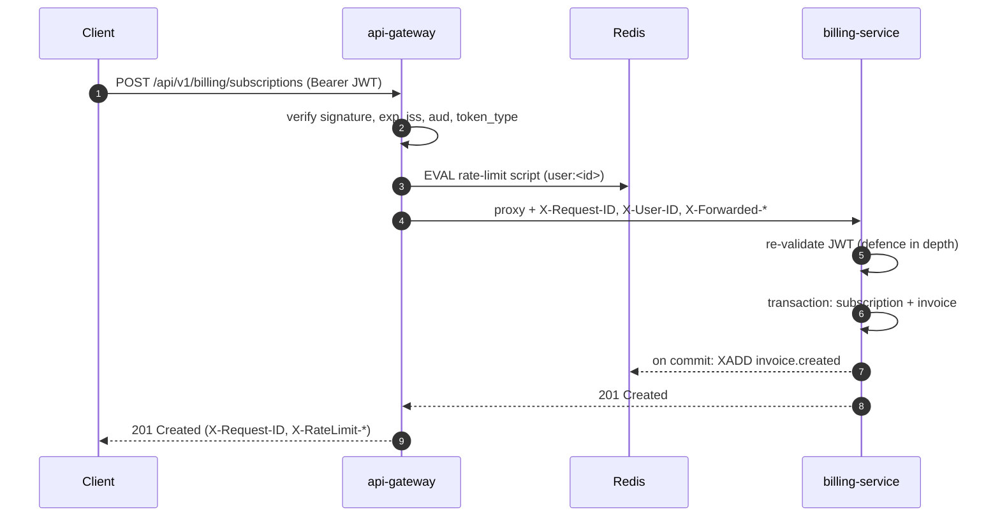

# xosting.net — Backend Platform

A polyglot microservices backend for **xosting.net**, a web-hosting and domain provider:
customer accounts, billing and subscriptions, ISPmanager-backed hosting, domain and DNS
management, real-time support chat, and email/Telegram notifications.

| | |
|---|---|
| **Languages** | Python 3.12 (Django 6, FastAPI), Go 1.27 |
| **Data** | PostgreSQL 17 (one database per service), Redis 7 (Streams, Pub/Sub, Celery broker, rate limits, cache) |
| **Runtime** | Docker (multi-stage, non-root, distroless for Go), Kubernetes (kustomize) |
| **Observability** | Structured JSON logs, Prometheus RED metrics, OpenTelemetry tracing |
| **Quality** | 79 automated tests, ruff/gofmt/go vet, CI on every push |

---

## Contents

- [Architecture](#architecture)
- [Services](#services)
- [Event catalogue](#event-catalogue)
- [Repository layout](#repository-layout)
- [Run locally (Docker Compose)](#run-locally-docker-compose)
- [API tour](#api-tour)
- [Testing](#testing)
- [Deploy to Kubernetes](#deploy-to-kubernetes)
- [Configuration](#configuration)
- [Observability](#observability)
- [Security model](#security-model)
- [Design decisions](#design-decisions)
- [Roadmap](#roadmap)

---

## Architecture



**Communication styles**

| Style | Used for | Technology |
|---|---|---|
| Synchronous request/response | Client → gateway → service | HTTP/JSON, WebSocket |
| Asynchronous domain events | "Something happened" fan-out (invoice paid, ticket replied…) | Redis Streams + consumer groups (at-least-once, replayable) |
| Real-time fan-out | Live ticket chat across replicas | Redis Pub/Sub |
| Background jobs | Renewals, dunning, expiry | Celery + Celery beat |
| Service-to-service lookup | Notification recipient resolution | Internal HTTP API guarded by `X-Internal-Token` |

### Request flow



## Services

| Service | Stack | Port | Responsibility |
|---|---|---|---|
| [`api-gateway`](services/api-gateway) | Go `net/http` + `httputil.ReverseProxy` | 8080 | Single public entry point: routing, JWT validation, Redis rate limiting (per user / per IP, strict on credential endpoints), CORS, security headers, request IDs, WebSocket proxying, trusted-proxy aware client IPs. |
| [`auth-service`](services/auth-service) | Django 6 · DRF · SimpleJWT | 8000 | Users (UUID, email login, roles), registration, JWT issue/refresh/rotation/blacklist, logout, profile, password change with global session revocation, Django admin, internal contact API. |
| [`billing-service`](services/billing-service) | Django 6 · DRF · Celery | 8000 | Plan catalogue, subscriptions, invoices with gap-free numbering, idempotent payments, renewal invoicing, dunning (overdue → past due → suspended), expiry of cancelled subscriptions. |
| [`hosting-service`](services/hosting-service) | FastAPI · SQLAlchemy 2 (async) · Alembic | 8000 | Shared-hosting accounts provisioned on **ISPmanager 6** (user + web domain), suspend/resume/terminate, panel password reset. Idempotent provisioning workflow. |
| [`domain-service`](services/domain-service) | FastAPI · SQLAlchemy 2 (async) · Alembic | 8000 | TLD price list, availability via **RDAP** (cached), registration requests, nameservers, DNS zone records with RFC validation (A, AAAA, CNAME, MX, TXT, NS, SRV, CAA; CNAME exclusivity). |
| [`support-service`](services/support-service) | FastAPI · WebSocket · Redis Pub/Sub | 8000 | Helpdesk tickets and conversations; live chat over WebSocket that works across any number of replicas. |
| [`notification-service`](services/notification-service) | Go · go-redis | 8090 | Consumes `xosting.events` via a consumer group; renders templates; delivers email (SMTP, STARTTLS/TLS) and Telegram; per-channel de-duplication, retries, dead-letter stream. |

Shared libraries live in [`shared/`](shared) — one directory that is **both** a Python
package (`xosting_shared`) and a Go module, so every language follows the same
conventions:

| Package | Python | Go |
|---|---|---|
| `shared/logger` | JSON formatter, Django & ASGI request-context middleware | `log/slog` JSON handler with request/trace IDs |
| `shared/metrics` | Prometheus RED middleware (Django & ASGI), multiprocess-aware | Prometheus RED middleware, hijack-safe status recorder |
| `shared/tracing` | Opt-in OpenTelemetry (OTLP/HTTP) for Django & FastAPI | Opt-in OpenTelemetry tracer provider, `otelhttp` helpers |
| `shared/security` | JWT validation + FastAPI dependencies | — (gateway has its own validator) |
| `shared/events` | Redis Streams event publisher (sync & async) | — (consumer lives in notification-service) |
| `shared/fastapi_kit` | Error envelope, probes, observability wiring | — |

## Event catalogue

All events share one envelope (`id`, `type`, `source`, `occurred_at`, `user_id`, `payload`)
and are appended to the `xosting.events` stream. Events are published **after** the
database transaction commits.

| Event | Producer | Notification |
|---|---|---|
| `user.registered` | auth | Welcome email |
| `user.password_changed` | auth | Security alert (email + Telegram) |
| `invoice.created` / `invoice.paid` / `invoice.overdue` | billing | Email + Telegram |
| `subscription.activated` / `.renewed` / `.reactivated` / `.cancelled` / `.expired` | billing | — (consumed by future automation) |
| `subscription.suspended` | billing | Email + Telegram |
| `hosting.account.provisioned` | hosting | Email + Telegram with panel details |
| `hosting.account.failed` | hosting | Staff Telegram alert |
| `hosting.account.suspended` / `.active` / `.terminated`, `hosting.password_reset` | hosting | — |
| `domain.registration_requested` | domain | Staff Telegram alert |
| `domain.registered` | domain | Email + Telegram |
| `support.ticket.created` | support | Staff Telegram alert |
| `support.ticket.replied` | support | Email + Telegram to the customer |

## Repository layout

```
xosting-backend/
├── services/
│   ├── api-gateway/            Go: cmd/, internal/{auth,config,gateway,middleware,proxy,ratelimit}
│   ├── auth-service/           Django: config/, apps/{accounts,core}
│   ├── billing-service/        Django + Celery: config/, apps/{billing,core}
│   ├── hosting-service/        FastAPI: app/, migrations/ (Alembic), tests/
│   ├── domain-service/         FastAPI: app/, migrations/, tests/
│   ├── support-service/        FastAPI: app/ (REST + WebSocket), migrations/, tests/
│   └── notification-service/   Go: cmd/, internal/{channels,contacts,dispatcher,events,templates}
├── shared/                     Python package + Go module: logger, metrics, tracing, security, events
├── infrastructure/
│   ├── docker/                 One multi-stage Dockerfile per service (+ postgres init script)
│   ├── k8s/                    Kustomize base: Deployments, Services, Ingress, ConfigMap,
│   │                           Secret generator, StatefulSets, Jobs, HPA, PDB, NetworkPolicies
│   ├── observability/          Prometheus scrape config
│   └── docker-compose.yml      Full local stack
├── .github/workflows/ci.yml    Lint + test matrix, manifest validation, image publishing
├── Makefile                    up · down · migrate · test · build · deploy-k8s · …
├── .env.example                Every environment variable, documented
└── go.work                     Go workspace for the gateway, notifier and shared module
```

## Run locally (Docker Compose)

**Prerequisites:** Docker 24+ with Compose v2, GNU Make.

```bash
git clone https://github.com/shamshodbekdev/xosting-backend.git
cd xosting-backend

make env        # creates .env from .env.example (safe dev defaults)
make up         # builds and starts the whole stack
make migrate    # runs Django + Alembic migrations, seeds the plan catalogue
make superuser  # optional: Django admin at http://localhost:8080/api/v1/auth/admin/
```

| URL | What |
|---|---|
| http://localhost:8080 | API gateway (the only public port) |
| http://localhost:8080/api/v1/auth/docs/ | auth-service Swagger UI |
| http://localhost:8080/api/v1/billing/docs/ | billing-service Swagger UI |
| http://localhost:8080/api/v1/hosting/docs | hosting-service Swagger UI |
| http://localhost:8080/api/v1/domains/docs | domain-service Swagger UI |
| http://localhost:8080/api/v1/support/docs | support-service Swagger UI |
| http://localhost:8025 | Mailpit: every email the platform sends |

Other useful targets: `make logs SERVICE=billing-worker`, `make ps`, `make down`,
`make clean` (also deletes volumes), `make up-observability` (adds Prometheus and Jaeger).

> **ISPmanager in development:** `hosting-service` talks to the panel set in
> `ISPMANAGER_URL`. Without a reachable panel, accounts move to `failed` with a
> descriptive `last_error` (which is the intended behaviour). Point it at a test panel to provision for real.

## API tour

```bash
API=http://localhost:8080

# 1. Register (returns the user and a token pair)
curl -s $API/api/v1/auth/register -H 'Content-Type: application/json' \
  -d '{"email":"aziz@example.com","password":"Sup3r-Secret-Pass","first_name":"Aziz"}'

# 2. Log in
TOKEN=$(curl -s $API/api/v1/auth/token -H 'Content-Type: application/json' \
  -d '{"email":"aziz@example.com","password":"Sup3r-Secret-Pass"}' | jq -r .access)

# 3. Public catalogue and domain search
curl -s "$API/api/v1/billing/plans?service_type=hosting"
curl -s "$API/api/v1/domains/availability?name=mening-saytim.uz"

# 4. Subscribe to a plan: creates a pending subscription and an invoice
curl -s $API/api/v1/billing/subscriptions -H "Authorization: Bearer $TOKEN" \
  -H 'Content-Type: application/json' -d '{"plan_code":"hosting-start"}'

# 5. Open a support ticket, then chat live over WebSocket
curl -s $API/api/v1/support/tickets -H "Authorization: Bearer $TOKEN" \
  -H 'Content-Type: application/json' \
  -d '{"subject":"SSL question","department":"technical","body":"Hi!"}'
# websocat "ws://localhost:8080/ws/support/tickets/<ticket_id>?access_token=$TOKEN"
#   -> {"type":"message","body":"Hello from the socket"}
```

Errors use the same envelope in every service, Python or Go:

```json
{"error": {"code": "validation_error", "message": "Request validation failed.", "details": {...}},
 "request_id": "6f1c0e7d9a2b4c1e8f3a5b7c9d0e1f2a"}
```

## Testing

```bash
make test                       # every service, inside Docker (Dockerfile "test" stage)
make test SERVICE=api-gateway   # a single service
make lint                       # local ruff + gofmt + go vet (needs local toolchains)
```

Each Dockerfile has a `test` stage that runs the linters and the test suite against the
exact dependency set of the production image, so `make test` needs nothing but Docker,
and CI runs the same thing.

| Service | Highlights of what is covered |
|---|---|
| auth | registration + event emission, duplicate/weak passwords, JWT claims, logout blacklisting, password change revokes sessions, throttling (and fail-open on cache outage), internal API auth, probes |
| billing | catalogue, ownership isolation, idempotent payments, wrong amount / double pay, activation, renewal generation (idempotent), dunning to suspension, expiry, sequential invoice numbers |
| hosting | provisioning against a fake ISPmanager, error mapping, duplicate domains, staff-only lifecycle, password reset, credentials never sent in the URL |
| domain | RDAP available/taken/unknown, caching, IDN names, registration flow, privacy, nameserver and DNS-record validation, CNAME exclusivity |
| support | conversation status machine, privacy, customer permissions, WebSocket auth close codes, cross-channel fan-out through Pub/Sub |
| notification | consumer ack/retry/dead-letter (miniredis), per-channel de-duplication, staff routing, templates, SMTP MIME encoding, Telegram errors do not leak the token |
| gateway | routing table, identity header injection and anti-spoofing, auth policy (missing/garbage/expired/refresh tokens), 404 for `/internal`, rate limiting and fail-open, CORS, WebSocket tunnelling, trusted-proxy IP resolution |

## Deploy to Kubernetes

The manifests in [`infrastructure/k8s`](infrastructure/k8s) form a kustomize base:

- `Namespace` with the **restricted** Pod Security Standard enforced
- `Deployment` + `Service` per service; separate Celery `billing-worker` and singleton `billing-beat`
- `StatefulSet`s for PostgreSQL and Redis (swap for managed services in production)
- `Job`s for database migrations, run before rollouts
- `ConfigMap` for configuration; `Secret` generated from a git-ignored `secrets.env`
- `Ingress` (ingress-nginx + cert-manager TLS, WebSocket timeouts)
- `HorizontalPodAutoscaler`s, `PodDisruptionBudget`s, default-deny `NetworkPolicy`s
- Startup, readiness and liveness probes, resource requests and limits, read-only root filesystems,
  dropped capabilities, non-root UIDs, `preStop` drain hooks, topology spread

**Cluster prerequisites:** ingress-nginx, cert-manager with a `letsencrypt-prod`
ClusterIssuer, metrics-server, and a default StorageClass.

```bash
# 1. Build and push images (or let CI publish them to GHCR on every push to main)
make push TAG=v1.0.0

# 2. Provide secrets (never committed)
cp infrastructure/k8s/secrets.env.example infrastructure/k8s/secrets.env
$EDITOR infrastructure/k8s/secrets.env

# 3. Deploy: migration Jobs → wait → rolling updates → wait for rollouts
make deploy-k8s TAG=v1.0.0

make k8s-status        # inspect workloads
make k8s-render        # print the fully rendered manifests
```

The pipeline is GitOps-ready: `kubectl kustomize infrastructure/k8s` output can be
handed to Argo CD or Flux unchanged.

## Configuration

Every variable is documented in [`.env.example`](.env.example) (Compose) and
[`infrastructure/k8s/configmap.yaml`](infrastructure/k8s/configmap.yaml) /
[`secrets.env.example`](infrastructure/k8s/secrets.env.example) (Kubernetes).
Services follow the twelve-factor model: they read configuration only from the
environment and fail fast on startup if a required value is missing.

## Observability

- **Logs:** one JSON object per line from every service, with `service`, `request_id`
  and, when tracing is enabled, `trace_id`/`span_id`. The gateway generates
  `X-Request-ID` and every hop propagates it, so a single request can be followed
  across all services.
- **Metrics:** `/metrics` on every service with the same metric names in both languages
  (`http_requests_total`, `http_request_duration_seconds`, `http_requests_in_progress`)
  plus domain metrics: `events_processed_total`, `notifications_sent_total`,
  `gateway_rate_limited_total`, `gateway_auth_failures_total`,
  `support_websocket_connections_active`. Route labels are path *templates*, which keeps cardinality bounded.
- **Tracing:** set `OTEL_EXPORTER_OTLP_ENDPOINT` to export OpenTelemetry spans
  (W3C trace context is propagated by the gateway). `make up-observability`
  starts Jaeger at http://localhost:16686 and Prometheus at http://localhost:9090.
- **Probes:** `/healthz` (liveness) and `/readyz` (checks PostgreSQL/Redis) everywhere.

## Security model

- **Edge authentication, plus checks in every service.** The gateway validates JWTs
  (signature, `exp`, `iss`, `aud`, `token_type=access`) and every service validates
  them again, so a misrouted request is still rejected.
- **No identity spoofing:** inbound `X-User-*` headers are stripped at the gateway.
- **Short-lived access tokens** (15 min) with rotating refresh tokens and blacklisting;
  changing a password revokes every session.
- **Brute-force protection:** strict per-IP limits on login/registration at the gateway,
  plus DRF throttles in auth-service. The limiter fails open, so a Redis outage cannot take
  the API down.
- **Client IPs** come from `X-Forwarded-For` only when the request arrives through a
  configured trusted proxy CIDR.
- **Internal endpoints** (`/internal/*`) are never routed publicly and require a shared token
  compared in constant time.
- **Secrets stay out of URLs and logs:** ISPmanager credentials go in POST bodies,
  WebSocket `access_token` query parameters are redacted in access logs, and Telegram errors never
  include the bot token.
- **Containers:** non-root, read-only root filesystem, all capabilities dropped,
  seccomp `RuntimeDefault`, distroless images for Go.
- **Network:** default-deny ingress `NetworkPolicy`; only the gateway is reachable from the ingress controller.

## Design decisions

| Decision | Why |
|---|---|
| **Database per service** | Services own their data and schema, can migrate independently, and cannot couple through tables. |
| **Redis Streams for events** (not Pub/Sub) | Consumer groups give at-least-once delivery, replay, horizontal scaling of consumers and a dead-letter path. Pub/Sub is used only for ephemeral chat fan-out. |
| **Events published on commit** | `transaction.on_commit` / post-commit publishing means consumers never see events for rolled-back data. |
| **Idempotency everywhere** | Payments require an `Idempotency-Key`; renewal invoices are unique per period (DB constraint); provisioning treats "already exists" as success; notifications are de-duplicated per event and channel. |
| **Gateway on Go `net/http`** instead of Kong or Fiber | Native WebSocket upgrade support in `httputil.ReverseProxy`, zero framework lock-in, and full control over auth, rate limiting and observability in under 1,000 lines of tested code. |
| **Async SQLAlchemy 2 + Alembic** for FastAPI services | Non-blocking I/O for services that call external APIs (ISPmanager, RDAP) and hold WebSockets. |
| **Django for auth and billing** | Mature ORM transactions and row locking, admin back-office, and a DRF/SimpleJWT ecosystem suited to identity and money. |
| **Test stage in every Dockerfile** | CI and developers run the same command against the same dependencies as production. |

## Roadmap

This is **Phase 1**: the platform scaffold with working core domain logic. Planned next:

- Payment provider adapters (Payme, Click, Uzum) on top of the existing idempotent `record_payment`
- Registrar integration (EPP / reseller API) to complete `domain.registration_requested`
- Event-driven provisioning: `subscription.activated` → hosting account; `subscription.suspended` → panel suspension
- Transactional outbox for guaranteed event delivery
- RS256 + JWKS endpoint so verifiers hold only public keys
- Helm chart / Argo CD application, Grafana dashboards and alert rules

---

*Built with Django, FastAPI, Go, PostgreSQL, Redis, Celery, Docker and Kubernetes.*
